<div align="center">

<picture><source media="(prefers-color-scheme: dark)" srcset="assets/banner-dark.svg">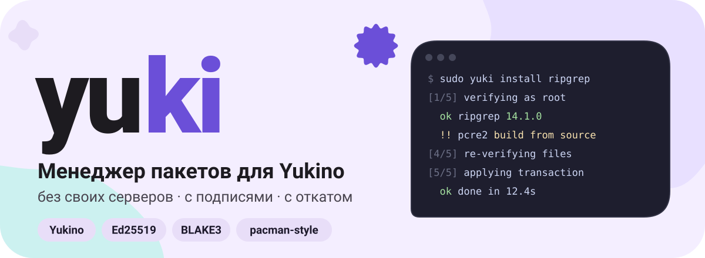</picture>

<sub>The package manager for Yukino. No servers, with signatures and rollback.</sub>

<p>
<a href="#start"><picture><source media="(prefers-color-scheme: dark)" srcset="assets/btn-start-dark.svg"></picture></a>
<a href="TUTORIAL.md"><picture><source media="(prefers-color-scheme: dark)" srcset="assets/btn-tutorial-dark.svg"></picture></a>
</p>
<p>
<a href="DESIGN.md"><picture><source media="(prefers-color-scheme: dark)" srcset="assets/btn-security-dark.svg"></picture></a>
<a href="#commands"><picture><source media="(prefers-color-scheme: dark)" srcset="assets/btn-commands-dark.svg"></picture></a>
</p>

<picture><source media="(prefers-color-scheme: dark)" srcset="assets/status-dark.svg"></picture>

<p>
<picture><source media="(prefers-color-scheme: dark)" srcset="assets/stat-cmds-dark.svg"></picture>
<picture><source media="(prefers-color-scheme: dark)" srcset="assets/stat-errors-dark.svg">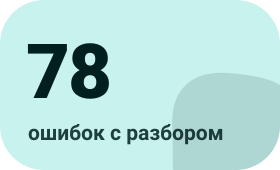</picture>
<picture><source media="(prefers-color-scheme: dark)" srcset="assets/stat-servers-dark.svg">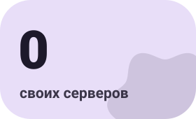</picture>
<picture><source media="(prefers-color-scheme: dark)" srcset="assets/stat-modes-dark.svg"></picture>
</p>

</div>

<picture><source media="(prefers-color-scheme: dark)" srcset="assets/divider-dark.svg"></picture>

<a name="about"></a>
##  Что это

**yuki** ставит приложения в систему (`sudo yuki install`, как pacman) и библиотеки в проекты (`yuki add`, запись в `yuki.toml`).
Реестр это обычный git-репозиторий: файлы раздаёт GitHub, а доверие строится на подписях и хешах, поэтому **свои серверы не нужны**.

<p align="center">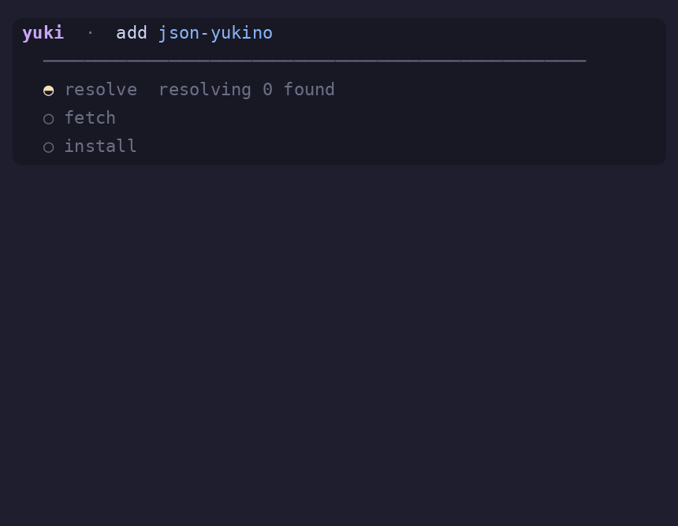</p>
<p align="center"><sub>Живая панель: фазы сверху, дерево зависимостей растёт снизу, загрузки идут параллельно</sub></p>

<table align="center">
<tr>
<td><picture><source media="(prefers-color-scheme: dark)" srcset="assets/card-signed-dark.svg">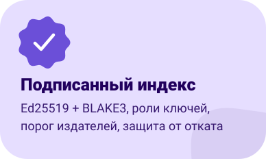</picture></td>
<td><picture><source media="(prefers-color-scheme: dark)" srcset="assets/card-priv-dark.svg">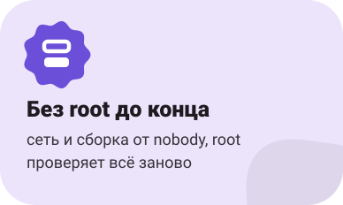</picture></td>
<td><picture><source media="(prefers-color-scheme: dark)" srcset="assets/card-fast-dark.svg">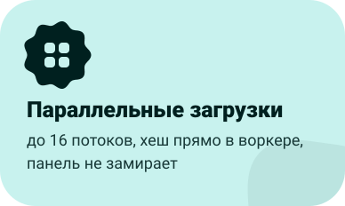</picture></td>
</tr>
<tr>
<td><picture><source media="(prefers-color-scheme: dark)" srcset="assets/card-tx-dark.svg">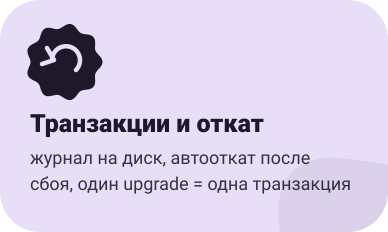</picture></td>
<td><picture><source media="(prefers-color-scheme: dark)" srcset="assets/card-build-dark.svg"></picture></td>
<td><picture><source media="(prefers-color-scheme: dark)" srcset="assets/card-graph-dark.svg">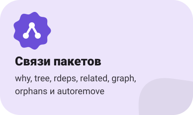</picture></td>
</tr>
</table>

<a name="start"></a>
##  Быстрый старт

<table>
<tr><td width="96" valign="top"></td><td valign="top"><b>Соберите и проверьте сборку</b><br>первая сборка покажет ошибки компиляции, исправьте их, затем <code>selftest</code> сверит хеши, подписи и потоки с эталонами</td></tr>
</table>

```bash
cd yuki && yukino build --release
sudo install -m 755 target/release/yuki /usr/local/bin/yuki
yuki selftest && yuki doctor
```

<table>
<tr><td width="96" valign="top"></td><td valign="top"><b>Укажите индекс и доверенный ключ</b><br>отпечаток ключа покажут и попросят подтвердить</td></tr>
</table>

```bash
sudo mkdir -p /etc/yuki
echo https://raw.githubusercontent.com/YOU/yuki-index/main | sudo tee /etc/yuki/index_url
sudo yuki keys trust main <публичный-ключ>
```

<table>
<tr><td width="96" valign="top"></td><td valign="top"><b>Пользуйтесь</b><br>флаги как у pacman работают</td></tr>
</table>

```bash
yuki -Ss grep                  # поиск
yuki -Si ripgrep               # описание
sudo yuki -S ripgrep pcre2     # установка, одним планом и одной транзакцией
sudo yuki -Syu                 # обновить всё, тоже одной транзакцией
sudo yuki -Rs ripgrep          # удалить вместе с ненужными зависимостями
yuki related ripgrep           # что с чем связано
sudo yuki rollback             # отменить последнюю транзакцию
```

<a name="how"></a>
##  Как проходит установка

Root появляется только там, где нужно менять систему, и ничему не верит на слово.

<table>
<tr><td width="96" valign="top"></td><td valign="top"><b>Ребёнок приносит записи индекса</b><br><code>fork</code>, отказ от root, <code>no_new_privs</code></td><td valign="top" align="right"></td></tr>
<tr><td width="96" valign="top"></td><td valign="top"><b>Root заново проверяет и строит план</b><br>подпись, срок, откат, роли ключей, подтверждение содержимого, вопрос «продолжить?»</td><td valign="top" align="right"></td></tr>
<tr><td width="96" valign="top"></td><td valign="top"><b>Параллельное скачивание и сборка</b><br>пул потоков, хеш считается в воркере; сборка в bubblewrap без сети, результат сверяется с подписанным хешем</td><td valign="top" align="right"></td></tr>
<tr><td width="96" valign="top"></td><td valign="top"><b>Root копирует к себе и проверяет файлы</b><br>BLAKE3, аудит архива, политика путей, безопасные симлинки, процессы nobody убиты</td><td valign="top" align="right"></td></tr>
<tr><td width="96" valign="top"></td><td valign="top"><b>Транзакция с журналом</b><br>журнал и резервные копии на диск до первого изменения, автооткат после сбоя</td><td valign="top" align="right"></td></tr>
</table>

<a name="commands"></a>
##  Команды

`yuki help <команда>` даёт примеры, `yuki explain Y0301` объясняет любую ошибку, при опечатке подсказывает правильную команду.

<table>
<tr><th align="left">Система (<code>sudo</code>)</th><th align="left">Посмотреть</th><th align="left">Проекты и сервис</th></tr>
<tr valign="top"><td>

`install` `reinstall`<br>
`uninstall [-s]` `autoremove`<br>
`upgrade` `self-update`<br>
`hold` `unhold`<br>
`rollback` `history`

</td><td>

`search` `show`<br>
`list` `info` `files` `owns`<br>
`why` `tree` `rdeps` `related`<br>
`graph [dot]` `orphans`<br>
`outdated` `check` `sys-audit`

</td><td>

`add` `remove` `update`<br>
`fetch` `audit`<br>
`keys` `theme` `pack`<br>
`index add|cosign|check|catalog`<br>
`doctor` `config` `clean` `selftest`

</td></tr>
</table>

<details><summary><b>Флаги как в pacman</b></summary>

| pacman | yuki | pacman | yuki |
|---|---|---|---|
| `-S pkg` | установить | `-Q` | список |
| `-Syu` | обновить всё | `-Qi pkg` | info |
| `-Ss слово` | поиск | `-Ql pkg` | files |
| `-Si pkg` | описание | `-Qo путь` | owns |
| `-R pkg` | удалить | `-Qe` / `-Qd` | явные / зависимости |
| `-Rs pkg` | с ненужными зависимостями | `-Qdt` | сироты |
| `-Sc` / `-Scc` | очистить кэш | `-Qu` / `-Qk` | устаревшие / проверка файлов |

</details>

<a name="security"></a>
##  Защита

| Угроза | Чем закрыта |
|---|---|
| Подмена архива или индекса | BLAKE3 + Ed25519, повторная проверка в root |
| Откат и «замороженный» индекс | `seq`, `expires`, локальное состояние `seen` |
| Утёкший ключ автопродления | роль `renewer` не может подписать содержимое релизов |
| Утёкший ключ издателя | порог издателей (`publish_threshold`), `cosign`, ротация и отзыв |
| Вредный архив | аудит до распаковки, политика путей, проверка симлинков, лимиты |
| Компрометация сети или сборки | разделение привилегий, bubblewrap, подписанный хеш результата |
| Сбой питания посреди установки | журнал на диск, автооткат при следующем запуске |

Подробно и **что не защищено** описано в [`DESIGN.md`](DESIGN.md).

<a name="look"></a>
##  Как выглядит

<table>
<tr>
<td>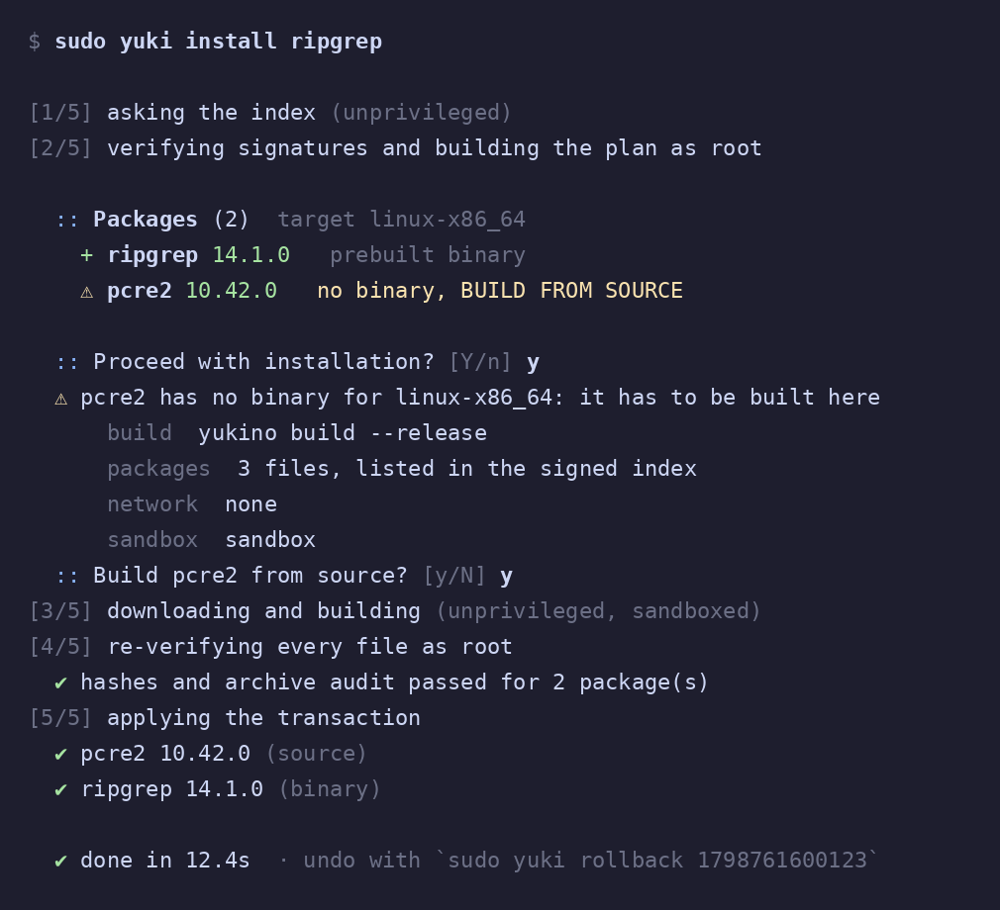</td>
<td>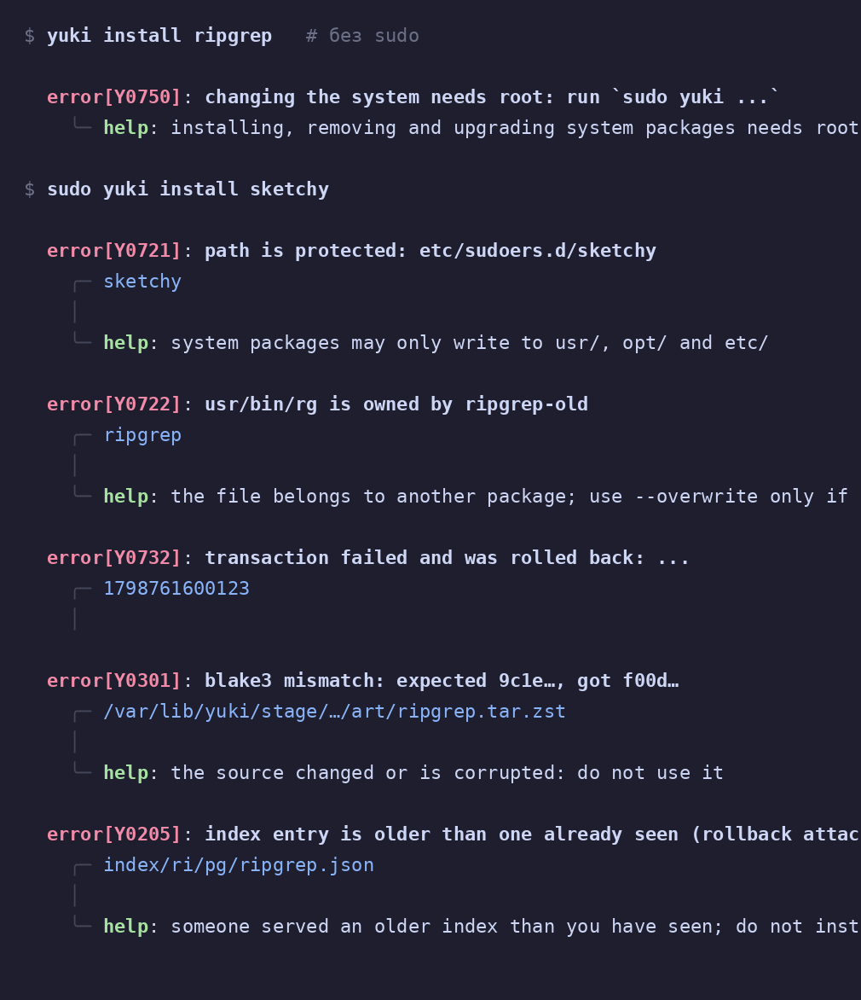</td>
</tr>
<tr>
<td align="center"><sub><code>sudo yuki install</code></sub></td>
<td align="center"><sub>ошибка всегда с <code>help</code> и ссылкой на <code>yuki explain</code></sub></td>
</tr>
</table>

<p align="center">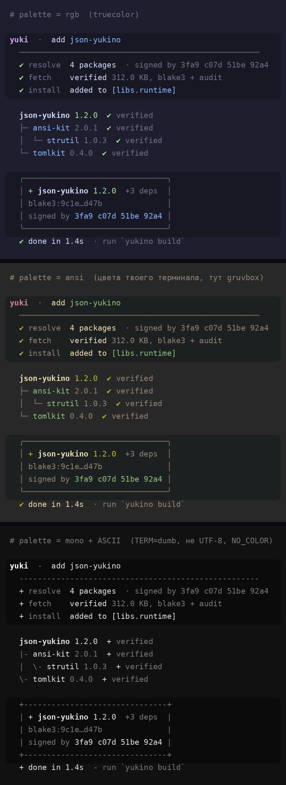</p>
<p align="center"><sub>Один результат в трёх режимах: truecolor, цвета вашего терминала (<code>palette = "ansi"</code>) и ASCII</sub></p>

Одна тема, настраиваемая файлом `theme.toml`: цвета, символы, анимация. Всё подстраивается само: truecolor → 256 → 16 → без цвета,
UTF-8 → ASCII, живой терминал → простой лог для CI. `NO_COLOR=1` работает.

<p align="center">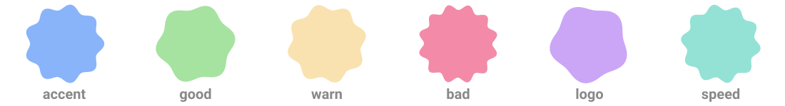</p>

```toml
# ~/.config/yuki/theme.toml  или  /etc/yuki/theme.toml
palette = "ansi"            # "rgb" | "ansi" (цвета терминала) | "mono"

[colors]
accent = "ansi:cyan"
bad    = "#f38ba8+bold"

[style]
animation = true
bar_gradient = true
```

> Картинки показывают логику кода, а не снимки реального запуска. Названия пакетов, хеши и цифры в них выдуманы.

<a name="index"></a>
##  Свой индекс за вечер

<table>
<tr><td width="96" valign="top"></td><td valign="top"><b>Репозиторий</b><br>скопируйте <code>yuki-index-template/</code>, включите защиту ветки <code>main</code> и CODEOWNERS</td><td valign="top" align="right"></td></tr>
<tr><td width="96" valign="top"></td><td valign="top"><b>Ключи</b><br><code>yuki keys gen main</code>, публичную часть в <code>keys/trusted_keys</code>, секрет офлайн</td><td valign="top" align="right"></td></tr>
<tr><td width="96" valign="top"></td><td valign="top"><b>Пакет</b><br><code>yuki pack</code> собирает архив и проверяет политику, релиз выкладывается на GitHub</td><td valign="top" align="right"></td></tr>
<tr><td width="96" valign="top"></td><td valign="top"><b>Запись</b><br><code>yuki index add релиз.json main</code> скачает, проверит и подпишет; второй издатель делает <code>cosign</code></td><td valign="top" align="right"></td></tr>
<tr><td width="96" valign="top"></td><td valign="top"><b>CI</b><br><code>yuki index check download</code> на каждый PR и ежемесячное продление ключом <code>renewer</code></td><td valign="top" align="right"></td></tr>
</table>

Пошагово: [`TUTORIAL.md`](TUTORIAL.md). Шаблон репозитория: [`yuki-index-template/`](yuki-index-template/).

<a name="faq"></a>
##  FAQ

<details><summary><b>Нужны ли мне свои серверы?</b></summary>
Нет. Индекс лежит в git-репозитории, клиент берёт файлы по HTTPS (можно указать несколько зеркал) и сам проверяет подписи.
</details>

<details><summary><b>Почему установка только через sudo?</b></summary>
Установка меняет систему. Но сеть и сборка выполняются без прав, а root проверяет всё заново и применяет одну транзакцию с журналом.
</details>

<details><summary><b>Что, если нет готового бинарника?</b></summary>
yuki покажет команду сборки, список файлов, режим песочницы и закреплён ли результат подписанным хешем, и спросит согласие. В скриптах нужен <code>--allow-build</code>.
</details>

<details><summary><b>Как обновляется сам yuki?</b></summary>
<code>sudo yuki self-update</code>. Новый бинарник обязан запуститься, иначе обновление откатывается.
</details>

<details><summary><b>Утёк ключ. Что делать?</b></summary>
Подписать <code>rotation.json</code> с отзывом нужным числом ключей и выполнить <code>sudo yuki keys refresh</code>. Отозванный ключ больше не вернётся.
</details>

<details><summary><b>Это уже работает?</b></summary>
Исходники написаны по документации Yukino, но ни разу не компилировались на реальной машине. Ожидайте ошибок при первой сборке, затем запустите <code>yuki selftest</code>.
</details>

<picture><source media="(prefers-color-scheme: dark)" srcset="assets/divider-dark.svg"></picture>

<p align="center"><sub>yuki · для <a href="https://github.com/yukitsuri/yukino">Yukino</a> · <a href="TUTORIAL.md">туториал</a> · <a href="DESIGN.md">модель защиты</a></sub></p>
